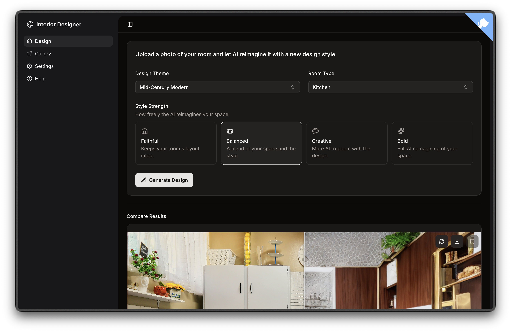
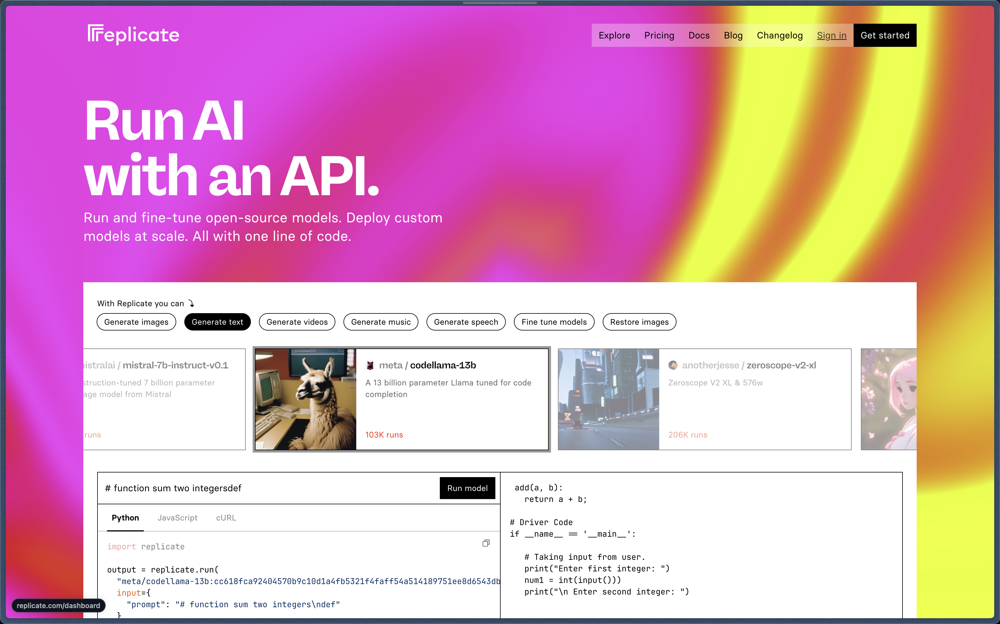
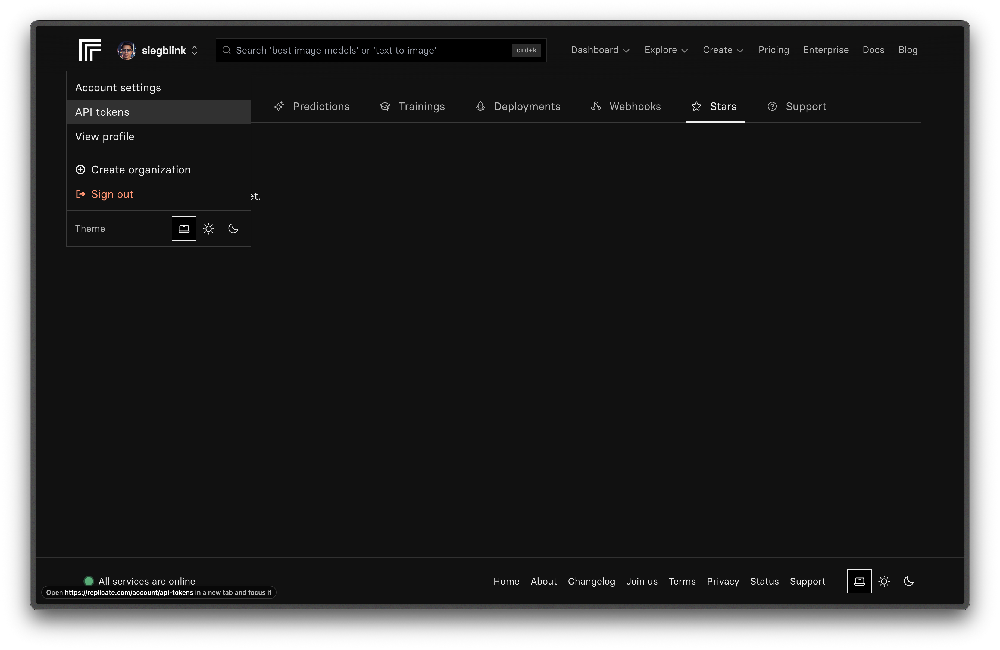
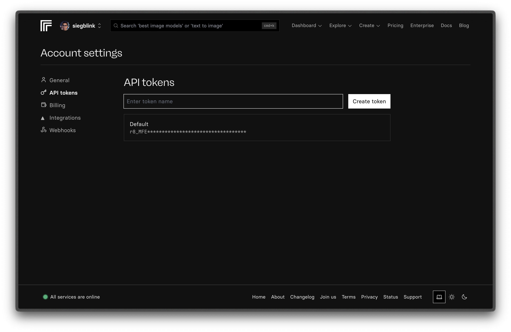
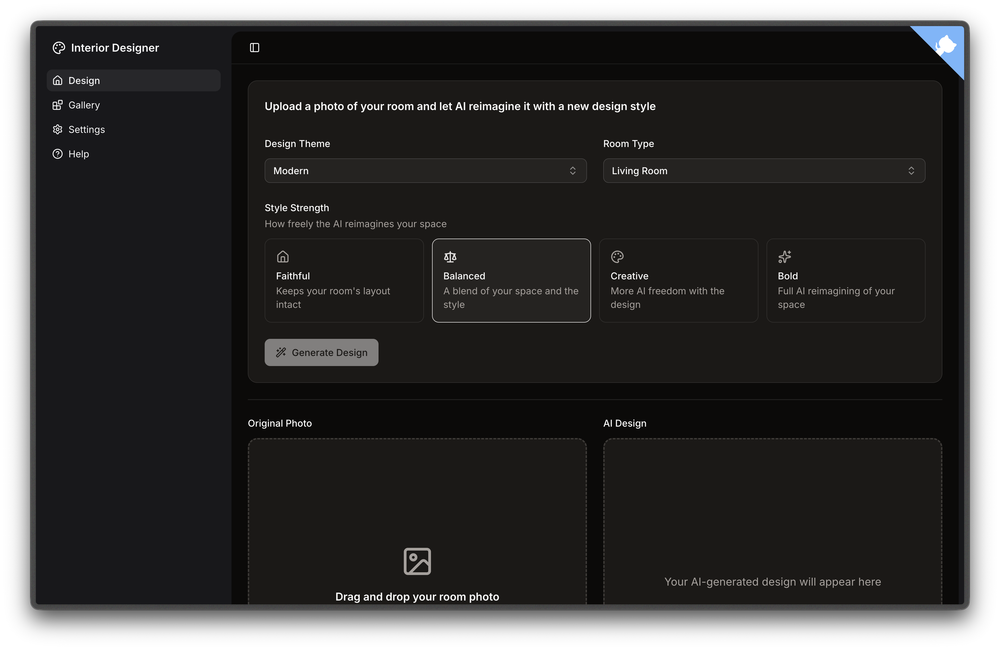

# Interior Designer AI



A modern, AI-powered application for transforming interior spaces with cutting-edge design. Upload a photo of your room and get a redesigned space in seconds.

## Features

- **AI-Powered Design** transformation using a ControlNet model on the Replicate API
- **8 Design Themes**: Modern, Minimalist, Scandinavian, Industrial, Bohemian, Traditional, Coastal and Mid-Century Modern
- **7 Room Types**: Living Room, Bedroom, Bathroom, Kitchen, Dining Room, Home Office and Kids Room
- **Style Strength Presets**: Faithful, Balanced, Creative and Bold, from keeping your layout to fully reimagining the space
- **Before/After Comparison Slider** to compare the original photo with the AI design, then download it or try again
- **Gallery** of saved designs, stored in Vercel Blob and visible to every visitor
- **Settings** for your default theme, room type and style strength (saved in your browser) and light, dark or system appearance
- **Admin Moderation** at `/admin`: a password-protected page to delete gallery designs one by one or in bulk
- **Help Page** with getting-started steps and FAQs
- **Responsive Design** with a collapsible sidebar on desktop and a slide-out menu on mobile

Uploads accept JPEG and PNG photos up to 5 MB.

## How to use

### 1. Clone this project's repository

In your Terminal app

```bash
# Clone the repo
git clone git@github.com:siegblink/interior-designer-ai.git
```

### 2. Install Bun (if not already installed)

**Bun** is a fast JavaScript runtime and package manager. Install it using:

```bash
# macOS/Linux
curl -fsSL https://bun.sh/install | bash

# Windows
powershell -c "irm bun.sh/install.ps1 | iex"
```

For more installation options, visit [https://bun.sh/docs/installation](https://bun.sh/docs/installation)

### 3. Install portless globally

**portless** provides a local HTTPS proxy so the app runs at `https://interior-design.localhost`. The `bun dev` script runs through it, so it is required for local development.

```bash
bun install -g portless
```

Next.js and portless both run on Node.js, so Node.js must also be installed (the repository's `.nvmrc` selects the current LTS release).

> On first run, portless will request your password to bind port 443 and install a local CA certificate so browsers trust the HTTPS connection.

### 4. Install the project dependencies

Go to the project's directory

- Type `cd interior-designer-ai`
- Then, `bun install`

### 5. Create an account at [replicate](https://replicate.com/)



### 6. Go to the _API tokens_ page within your replicate account



### 7. Create your API token and copy it



### 8. Copy the `.env.example` file to `.env.local`

```bash
cp .env.example .env.local
```

### 9. In `.env.local`, replace the placeholders with your own values

```
# Replicate API token (required to generate designs)
REPLICATE_API_TOKEN=your_api_token

# Vercel Blob read-write token (required to save designs to the gallery).
# Get this from your Vercel project dashboard → Storage → Blob → your store → .env.local
BLOB_READ_WRITE_TOKEN=your_blob_token

# Password for the /admin page, where gallery designs can be deleted.
GALLERY_ADMIN_SECRET=your_admin_password
```

- `REPLICATE_API_TOKEN` is the token you created in step 7.
- Without `BLOB_READ_WRITE_TOKEN`, generating designs still works, but the gallery stays empty and saving to it fails.
- `GALLERY_ADMIN_SECRET` is the password for `/admin`; without it, admin sign-in is always rejected. It also signs the admin session cookie, so changing it signs every admin out.

### 10. Run the project

Back in your Terminal in the project directory, type `bun dev`

### 11. See the running application in your browser at `https://interior-design.localhost`



## Abuse protection

Generating a design runs a paid model on your Replicate account, and the demo is public. The app limits how often its API can be called, but those limits are counted per server instance and reset on every deploy. Two settings that only the account owner can change are what actually bound abuse.

### What the app does on its own

- Each visitor (by IP address) can generate 10 designs at once, then one every 6 minutes. Gallery saves allow 5 at once, then one every 12 minutes, and admin sign-in allows 5 attempts, then one every 3 minutes.
- All visitors together can generate 200 designs and save 10 to the gallery per day. Change these with `GENERATION_DAILY_LIMIT` and `GALLERY_SAVE_DAILY_LIMIT`; 0 turns the feature off (requests then get a `503` saying so). The save limit is low because every save uses two of the Blob operations the Vercel Hobby plan includes (2,000 a month).
- Requests that a browser sends from another website are refused.
- A request over a limit gets a `429` response with a `Retry-After` header and a message saying when to try again. A cross-site request gets a `403`.

### What you need to set up

1. **Cap what Replicate can charge.** In your Replicate account, open Billing, pay with prepaid credit and turn auto reload off. Once the balance reaches zero no new predictions start, so the balance is the most you can lose. A design costs about $0.011.
2. **Add a rate-limit rule in the Vercel Firewall.** This is the only per-visitor limit that holds across server instances and deploys, and requests it refuses never reach the app. In the Vercel dashboard open your project, then Firewall, and add a rule:
   - If: Request Path equals `/api/replicate` and Method equals `POST`
   - Then: Rate Limit, Fixed Window, 600 seconds, 10 requests, keyed by IP
   - Action: Too Many Requests (429)

   Save the rule, review the changes and publish them. The Hobby plan includes one rate-limit rule.

3. **Check that the app can see visitor addresses.** In the project settings, under Environment Variables, "Enable access to System Environment Variables" must be on. Without it the per-visitor limits are skipped: generation and saves keep only their daily limits, and admin sign-in has no limit.

If someone is abusing the demo right now, turn on Attack Mode in the Firewall tab. It is free and the app keeps working for real visitors.

When self-hosting behind a reverse proxy, set `TRUSTED_IP_HEADER` to the header your proxy overwrites with the client address (for example `x-real-ip`). Without it the per-visitor limits are skipped.

## Technologies Used

- **Next.js 16** - React framework for production (App Router)
- **React 19** - UI component library
- **Tailwind CSS 4** - Utility-first CSS framework
- **shadcn/ui** - Accessible UI component library built on Radix UI
- **cmdk** - Command menu for searchable dropdowns
- **Replicate API** - For AI-powered design transformations
- **Vercel Blob** - Storage for the design gallery
- **react-compare-slider** - Before/after comparison slider
- **zod** and **React Hook Form** - Request and form validation
- **Bun** - Package manager, script runner and test runner (`bun test`); Next.js itself runs on Node.js
- **oxlint** and **oxfmt** - Linting and formatting, run on every commit by a Husky pre-commit hook

## Contributing

Contributions are welcome! Please read our [Code of Conduct](CODE_OF_CONDUCT.md) first.

## License

This project is open source and available under the [MIT License](LICENSE).
